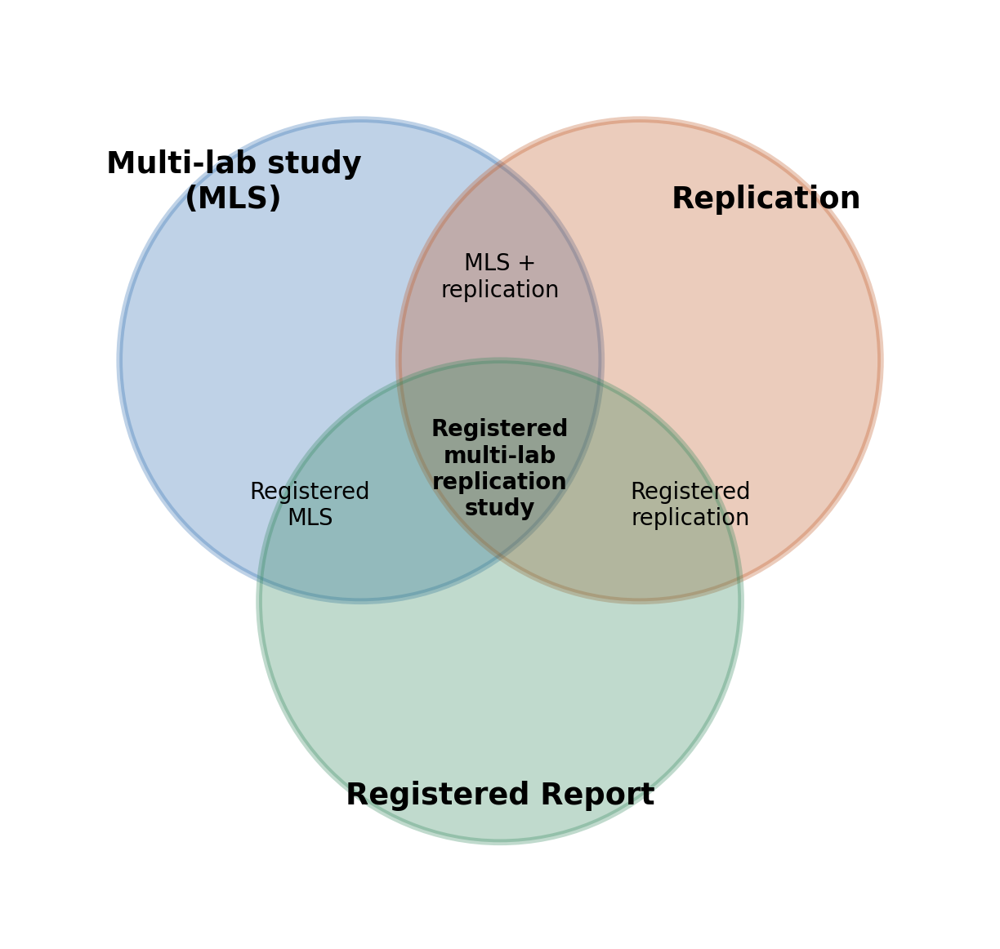
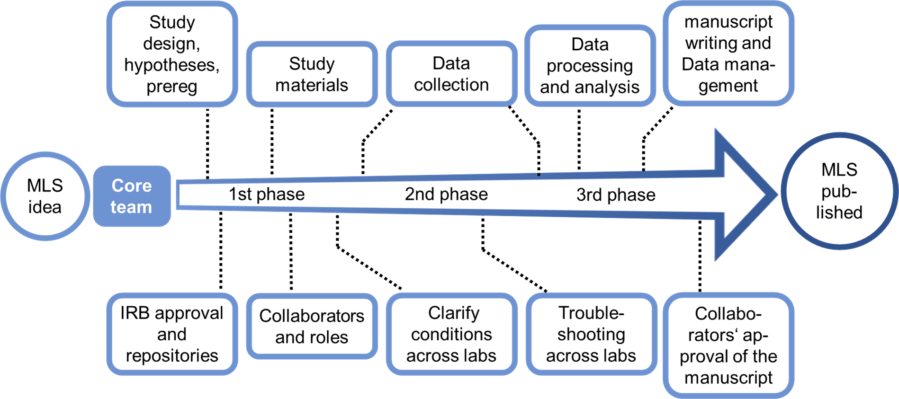

::: {.callout-tip icon="false"}
**Key takeaways**

Multi-lab studies (MLSs) let several laboratories run the same study, which yields larger and more diverse samples and more conclusive evidence than any single study. They are especially valuable when combined with replication and with Registered Reports. This experience report describes the process: building a small and committed core team, planning the design and preregistration, deciding whether to involve the original authors, securing ethics approval and a repository, recruiting collaborators, ensuring similar study conditions, supporting teams with unequal resources, and communicating regularly. MLSs take considerable time, but the robustness of the results, the checks and balances, and the lasting research networks make them worthwhile.

*After this chapter, you will know:*

-   Why and when is an MLS a good choice, and how does it relate to replications and Registered Reports?

-   Which steps does the organization of an MLS involve?

-   What challenges should a core team anticipate?
:::

The advent of multi-lab studies (MLSs) -- scientific studies conducted collaboratively by several laboratories or teams of scientists -- can be seen as one of the many consequences of the Replication Crisis [@ForscherEtAl2023]. Drawing on my own experiences, I aim to provide insights into how to organize an MLS. I do so in the form of an experience report, as several comprehensive guidelines on how to develop large-scale collaborative research projects already exist [see, e.g., @BaumgartnerEtAl2023; @VaidisEtAl2026]. First, I briefly introduce the concept of MLSs and situate it within the historical context of the Replication Crisis. Second, drawing on my experience [@BrohmerEtAl2024], I discuss why and under which circumstances conducting an MLS is useful. Third, I distinguish MLSs from other good research practices -- namely replications and Registered Reports, which can also be combined with an MLS. Finally, I describe the process of conducting an MLS in detail, including challenges that should be considered when organizing such a study. I do so in the hope that this article inspires more researchers to conduct MLSs in the future.

## From restricted samples to MLS: a historical abstract

In the past, researchers in the social and behavioral sciences, including psychology, often conducted experimental studies on a relatively small scale. Such small samples were associated with substantial sampling variability, which could distort true effects -- or null effects -- in both positive and negative directions [e.g., @ButtonEtAl2013], ultimately limiting the strength of the conclusions that could be drawn. Moreover, because these studies predominantly relied on student samples from Western Europe and the United States, they rarely accounted for cultural variation.

Such restricted sampling practices used to be common in many areas of psychology, largely due to environmental constraints. To put this into perspective, frequent communication between university laboratories only became common -- and, in many cases, possible -- in the mid-1990s, when the internet and email entered the mass market. Since then, organizing collaborative efforts has no longer been limited to meetings at conferences or correspondence by letter. Furthermore, online survey platforms only became widely available and accepted in the mid- to late 2010s, when stable broadband internet access became accessible to larger segments of society, first through home computers and later through smartphones. Before that time, much research involving questionnaires, reading tasks, or visual materials had to be conducted in university laboratories, through face-to-face interviews, via landline telephone calls (excluding visual presentations), by fax, or through postal mail (i.e., hard copies physically distributed to the public, often in collaboration with local authorities). Today, laboratory studies remain important, particularly when sophisticated equipment or procedures are required (e.g., eye tracking, EEG, fMRI, VR, or reaction-time experiments). In contrast, questionnaire-based research has largely migrated online.

It was not until the emergence of concerns about non-replicable research findings in 2011 and 2012 that restricted sampling practices came under scrutiny (alongside other issues related to the Replication Crisis). In particular, the seminal papers of the *Many Labs* project [@KleinEtAl2014] and the *Open Science Collaboration* [-@OpenScienceCollab2015] sparked initial interest in collaborative efforts to replicate prominent findings in psychological research. Furthermore, aided by the early involvement of Perspectives on Psychological Science [one of psychology's flagship journals, @SimonsEtAl2014], several multi-lab replication studies were conducted, sometimes using samples 15 to 20 times larger than those of the original studies. More often than not, these studies yielded effects that were substantially smaller (or close to zero) compared to the large effects reported in the original papers.

Between 2015 and 2025, the concept of MLSs evolved even further. First, the *Psychological Science Accelerator* (https://psysciacc.org/) was founded to facilitate the organization of MLSs on a global scale. MLSs also rose to global prominence when a team of 40,000 scientists analyzed emotional effects during the COVID-19 pandemic [e.g., @WangEtAl2021]. Second, proponents of big-team science developed innovative add-ons for MLSs, such as prediction markets [@CamererEtAl2018] and adversarial-collaboration approaches [@NosekErrington2020b; @NatureEditorial2025], which were used to contribute to heated debates surrounding controversial psychological effects. Third, the usefulness of such approaches spread to more resource-intensive subfields of psychology, such as neuroscience. Although organizing studies involving complex setups or hard-to-reach populations presents substantial challenges, many collaborating teams did not shy away from these endeavors (see, e.g., an EEG replication project on language comprehension by @NieuwlandEtAl2018 and the ManyBabies collaboration by @ByersHeinleinEtAl2020).

Since then, the field has entered a phase of consolidation, as MLSs have become increasingly common, slowly but steadily. Looking at the number of MLSs published in the prominent journal *Advances in Methods and Practices in Psychological Science* shows that, between 2019 and 2024, there were typically two to three multi-lab studies per year (excluding another large ManyLabs project). In 2025, this number rose to six.

## Reasons for Conducting an MLS

Although this gradual upward trend is encouraging, it also shows that MLSs are still more the exception than the rule in the field. This is not surprising, as such projects can easily be perceived as cumbersome, and the amount of work required from the principal investigators may seem enormous. Indeed, these studies typically take significantly more time to prepare, conduct, manage, and write up than an individual study. The MLSs with small to medium-sized core teams, that I have been participating with, which did not conduct these studies as their primary research, required about 4 to 5 years in total from planning to publication. Teams with the sole focus on such projects may require 1 to 3 years.^[These estimates, despite being informed, should be seen as anecdotal.] But this is only one side of the coin.

The other side of the coin is much brighter: research questions can be addressed collaboratively in MLSs, implying that the resulting findings are likely to provide more robust and conclusive evidence for the phenomenon of interest -- regardless of whether the outcome is a large effect or a null finding. No individual study could realistically provide such a level of credibility. In this way, MLSs may fulfill Merton's scientific norm of communality [@Merton1942] far better than any form of individualized research. Consequently, they are well suited both for investigating new effects, for example in time-sensitive situations where evidence is needed to inform the public (e.g., during COVID-19), and for replication projects aimed at obtaining new evidence regarding the presence (or absence) of an effect already reported in the literature.

Moreover, an MLS can ensure a higher degree of checks and balances. Throughout the research process, many eyes review research data, manuscripts, code, and study setups and may identify inconsistencies, typographical errors, coding issues, or incorrect translations of materials. As errors are inevitable in human work, detecting such issues can substantially improve the quality of the final output. In one example, a Master's student of mine who helped collect data for an MLS [@VaidisEtAl2024, acknowledgement section] identified a major problem in the coding of a key dependent variable. I reported this issue to the lead researchers, who were fortunately able to rerun the main analysis before publication. This problem would likely have gone unnoticed had so many researchers not been involved.

Finally, the individual medium- and long-term benefits for researchers involved in such studies should not be underestimated. As university press offices and public media outlets take note of MLSs, they are often more interested in reporting their results than those of similar but smaller studies. Likewise, because the very nature of MLSs implies greater robustness through the involvement of many laboratories, MLSs may be cited more frequently than comparable studies. However, this effect is difficult to estimate, as MLSs are often published in high-impact journals, which may itself account for their greater visibility and public exposure. Furthermore, the research networks established through MLS collaborations often remain intact after a project has been completed, leading to follow-up projects that address new research questions.

## Multiple conceptions for "good-practice" studies

This experience report, based on my own involvement in an MLS, occasionally refers to different concepts of "good practice" that were combined within a single study. As depicted in @fig-mls-concepts, I would like to conceptually disentangle these concepts for the sake of clarity.

**MLS**. Several laboratories or teams of scientists conduct the same study collaboratively. This is considered a good-practice approach because evidence for (or against) an effect is collected not just once, but multiple times, allowing researchers to assess whether a given effect is robust across laboratories.

**Replication**. A study that replicates a previous, original study, typically conducted by independent researchers. A formal distinction is commonly made between close and conceptual replications, among other types [see @HueffmeierEtAl2016]. This is a good-practice approach because replications (particularly close replications) provide additional evidence for or against an effect, thereby contributing to the cumulative body of scientific knowledge.

{#fig-mls-concepts}

**Registered Report.** A study in which the theoretical rationale and methodology are peer-reviewed prior to data collection. Registered Reports are typically conducted in collaboration with journals, which provide in-principle acceptance following a positive Stage 1 peer review and guarantee publication regardless of the study's results. This is a good-practice approach because it combats publication bias (i.e., the tendency to favor statistically significant findings), clearly distinguishes confirmatory from exploratory analyses, and tends to result in higher overall research quality [@ScheelEtAl2021; @SoderbergEtAl2021].

**Registered Multi-Lab Replication Study.** Combining these practices also combines the advantages of all three concepts. Thus, an MLS that replicates an original effect and preregisters its theoretical rationale and methodology (including hypotheses and analysis plans) safeguards itself against multiple criticisms that might arise post hoc. These include common questions such as:

-   "Is the study sufficiently powered to detect a potentially small effect?"; Answer: "Yes, as we provide a large sample drawn from multiple laboratories."

-   "Are the theoretical rationale and experimental paradigms sound?"; Answer: "Yes, according to both our collaborators and the a priori peer review process, they were."

-   "Does a single replication add anything new to the publication record?"; Answer: "Yes, because it draws on data from multiple laboratories and demonstrates whether the effect is truly robust across research settings."

## The process of an MLS

To realize the benefits of an MLS (with or without the additional advantages of a replication study or a Registered Report), careful planning, monitoring, and active involvement of collaborators are essential. This requires substantial effort on the part of the core research team or principal investigators. The following sections outline the key steps involved; @fig-mls-timeline gives a simplified overview.

**The generation of a study idea.** As with most ideas, research ideas may come to a researcher quite unexpectedly: perhaps in the shower, during a late-evening run in the park, over lunch with colleagues, or after reading a more or less related piece of research. Alternatively, they may emerge as a consequence of previous research that has opened up new questions. This stage is familiar to any researcher who has ever conducted a study.

**Building a core team.** Upon discussing the newly developed research idea with colleagues and deciding to conduct the study as an MLS, a core team needs to be formed. This core team should remain small -- potentially two to four people may be sufficient -- and should consist of researchers who feel directly invested in the project, trust one another in their respective roles, and proactively contribute to moving the study forward. Without these ingredients, the project may stall at an early stage due to a diffusion of responsibility or a lack of individual commitment. Depending on the size of the planned MLS, additional tiers of involved researchers may be established to facilitate the delegation of tasks and responsibilities.

**Planning the hypotheses, study design and paradigm.** One of the core team's first tasks is to define the general characteristics of the planned study at an early stage. Here, the Registered Report format can be particularly useful, as it requires researchers to discuss and document their theoretical rationale, hypotheses, and methods in detail for the review process. However, even if no pre-data-collection review is planned, a suitable preregistration template can provide valuable guidance. This process helps clarify important aspects of the study, including the anticipated sample size and the planned analysis pipeline. For replication studies, this process may be somewhat more straightforward, as the original study often provides both the initial theoretical rationale and an effect size that can serve as the basis for a sample size calculation. At the same time, methodological deviations from the original study may become apparent by comparing the methods section of the original paper with that of the planned replication [see, e.g., the Replication Recipe, @BrandtEtAl2014].

**Involving original authors (replications)**. For MLSs that involve replications, it is often worthwhile to consider involving the original authors. However, this can be a delicate matter. On the one hand, having the original authors on board can send a positive signal, demonstrating their confidence in the project. For older or less thoroughly documented studies, they may also be able to provide important details that are absent from the published methods section but may nevertheless be relevant (e.g., whether participants were tested individually or in groups, the characteristics of the laboratory environment, or whether the convenience sample primarily consisted of students). On the other hand, if the original authors are motivated to defend their previous findings, their involvement can also lead to friction regarding methodological decisions once they have joined the team. Therefore, it is advisable to approach original authors early in the planning process and assess whether their interests are aligned with the goals of the replication before offering a collaboration on equal footing. For example, if the original authors express an interest in investigating the robustness of their effect and openly discuss the possibility of involving additional laboratories, this may indicate a genuine commitment to the project's objectives.

**Ethics approval, data management and documentation**. The core team may also begin preparing the study's IRB approval and establishing an appropriate repository structure for data sharing and metadata management. Securing ethical approval early in the process can be particularly beneficial, as universities differ in how they handle IRB procedures. For potential collaborators (see the next section), this means that they may either need to obtain separate approval from their own institution or be able to join the existing approval. The latter option is generally preferable, as it can facilitate a faster start to the study. Likewise, an appropriate repository structure should be established early on to support effective data management and to document decisions and workflows throughout the project. This may include the use of version-controlled documents that make changes over time transparent and traceable.

**Finding collaborators**. Once the principal study idea and design are clear to the core team, they can begin recruiting collaborators. The difficulty of this task increases with the complexity of the study design or the target population. Finding collaborators for resource-intensive studies (e.g., EEG experiments) or studies involving specific populations (e.g., infants) requires substantial resources and may therefore reduce the pool of potential collaborators. In such cases, calls for participation through networks such as the Psychological Science Accelerator or email distribution lists of major psychological societies may be necessary. For less complex studies (e.g., 15-minute online experiments), the barriers to participation are often considerably lower. My own experience suggests that particularly motivated early-career researchers from adjacent fields can often be recruited at conferences, but also at multi-day summer schools or writing retreats, where there is sufficient time to explain the project in greater detail. Again, the Registered Report format can be helpful, as the study rationale, design, and procedures are already documented and can be shared with interested researchers. From the outset, the roles of collaborators should also be clearly defined. Will they simply conduct a study that has already been prepared? Will they be involved in coordination, data analysis, and manuscript writing? And what implications will their role have for eventual co-authorship? Such role definitions can be established efficiently through survey and communication platforms (e.g., Canvas, Moodle, Slack, or similar tools) or shared spreadsheets, where all involved parties can indicate their anticipated contributions. It should also be reiterated that for exceptionally large MLSs [e.g., @MiskeEtAl2026; @WangEtAl2021], a division of labor across multiple tiers of collaborators is advisable, as a small core team alone would likely be overwhelmed by the task of coordinating hundreds of laboratories and researchers.

**Assuring similar study conditions.** One of the greatest advantages of an MLS is that a core team can usually ensure a high degree of methodological homogeneity across participating studies, often exceeding that achieved in most meta-analyses [@LindenHoenekopp2021]. In particular, online questionnaire-based studies have the advantage of allowing highly standardized study designs. The primary challenge in such studies is that poor translations of materials into different languages may compromise data quality. Therefore, it is advisable to involve native speakers who can ensure accurate translations of the original study materials. As open-source alternatives often lag behind in usability, platforms such as Google Sheets and Google Docs are commonly used to share materials among collaborating researchers. More complex MLSs, however, particularly those requiring on-site participation, demand greater attention to minimizing unwanted sources of heterogeneity. Relevant questions may include:

-   Do the fMRI scanners used by participating laboratories provide comparable temporal and spatial resolution?

-   Do stationary and wearable eye-tracking systems produce equivalent results?

-   Do differences in illumination levels or screen sizes across laboratories affect reaction times?

Some of these questions may need to be addressed through extensive pilot testing, which requires additional time and resources. In certain cases, the core team may decide not to include particular laboratories if minimum requirements for methodological homogeneity are not met.

**Individual differences in researchers' behavior and actual resources.** During the course of the project, the core team may discover differences among collaborators with regard to communication, individual effort, or simply luck in accomplishing their tasks. For example, highly motivated collaborating teams may collect their share of the agreed sample size within a few days because they are well prepared and have effective local recruitment strategies in place. Other teams, by contrast, may make several attempts to recruit participants through social media and then find themselves surprised by how difficult and time-consuming it is to reach the desired sample size. Addressing such issues is a crucial responsibility of the core team. For instance, it may brainstorm alternative recruitment strategies with the collaborating team and offer help with the data collection. Alternatively, other laboratories may be able to contribute by recruiting additional participants to compensate for shortfalls elsewhere. In any case, core teams will likely encounter such unforeseen challenges throughout the project, and these situations should be addressed in a constructive and supportive manner.

**Post-data collection procedure.** Once all data have been collected, the core team typically begins processing and analyzing the data, followed by the preparation of the manuscript (or the Stage 2 Registered Report). Because MLS datasets often require extensive analyses---after all, the involvement of multiple laboratories already necessitates multilevel or meta-analytic approaches---these steps can take considerably longer than anticipated. This is especially true when additional good-practice measures are implemented, such as thoroughly annotating analysis code, preparing variable lists and codebooks, and organizing data and material sharing within the project repository. In the case of my own MLS [@BrohmerEtAl2024], this phase took almost as long as the Stage 1 registration and data collection combined, despite the involvement of student raters who assisted with some of the tasks.

**Team communication.** As many of the aforementioned steps can be more time-consuming than initially anticipated, maintaining good communication with collaborators is particularly important. Providing updates every two to three months, describing what has been accomplished in the meantime and what is planned for the coming months, is usually perceived as informative and helps collaborators feel involved in the project. As the manuscript draft approaches completion, collaborators also appreciate being informed early so that they can reserve sufficient time to read the manuscript and provide suggestions for potential revisions. Naturally, it is the responsibility of the core team to set a deadline by which collaborators should have reviewed the manuscript. However, the team should be sufficiently forward-looking not to make this deadline overly restrictive. Depending on the length and complexity of the manuscript, a minimum review period of two to three weeks should be provided. Again, online survey and communication tools can be used to allow collaborators to indicate when they have completed their review and submitted their comments. Finally, once the manuscript has been submitted, the core team should send a final update informing collaborators that they will be notified about the manuscript's progress when reviews are received and, ultimately, when the paper is accepted for publication.

{#fig-mls-timeline}

**The aftermath**. Once the MLS is published, it is unlikely to feel like "just another publication" to the core team and the involved collaborators. Instead, because an MLS typically contains much more information than a single study, its publication feels more like the completion of a comprehensive and conclusive research project that does justice to the underlying phenomenon of interest. And rightfully so: at least with regard to the research paradigm employed, the conclusions drawn from such a study are likely to be clearer and more replicable, as they are based on data from multiple laboratories and sample sizes that may be five, ten, or even one hundred times larger than those commonly found in the field. As a result, MLSs are also highly persuasive and communicable. It is therefore not surprising that they often attract the attention of science communicators, journalists, and decision-makers, who may bring their findings to a much broader audience and substantially increase their visibility.

## Final Thoughts and Conclusion

MLSs require careful planning and considerable time to conduct. This is likely one reason why researchers in the social and behavioral sciences do not engage in them more frequently, despite the availability of infrastructures that did not exist less than a generation ago. As discussed throughout this article, these concerns are not unfounded, as committing to an MLS requires substantial time and resources. However, motivated researchers should not be deterred by the organizational effort involved. Instead, the procedural steps outlined here can serve as a practical guide for effective planning and for avoiding common pitfalls. Moreover, conducting such a project with a team of equally committed collaborators can help sustain motivation over the months or even years that such studies often require.

In my view, managing an MLS represents the ultimate opportunity to collaboratively organize and socially coordinate a scientific study in the spirit envisioned by Merton [-@Merton1942]. Yet its value still appears to be underappreciated, much like that of many other forms of good-practice research in science. It is often only through firsthand experience that the benefits of such studies become fully apparent. Once experienced, they tend to shift attention away from the often unhealthy incentives of the academic publishing system---which frequently reward quantity and novelty---and toward the production of robust, cumulative scientific knowledge.
